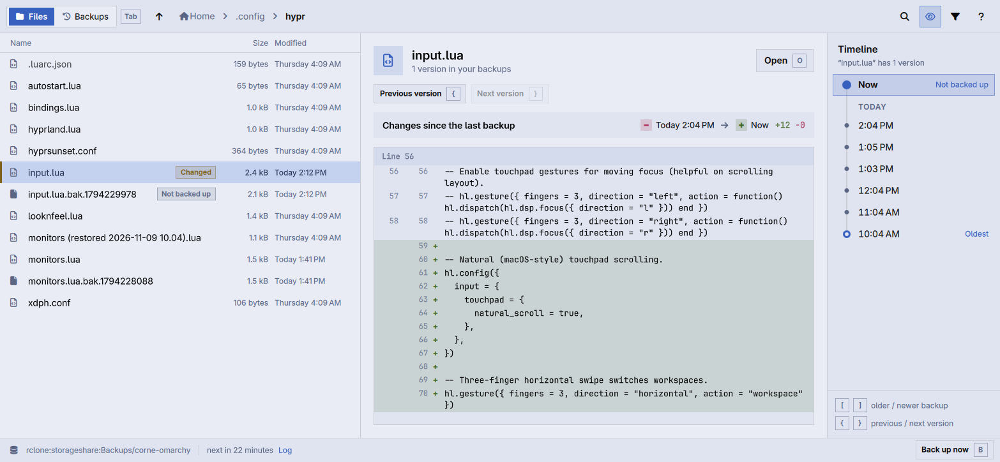

# Rewind

Browse your restic backups like a time machine. Pick a folder, step back
through your backups, and see what each file looked like then: what changed
since, what was deleted, and every distinct version of a file on one timeline.
Restore a version beside the current file or in its place, and undo it.



Rewind opens the repository your backups already use. It reads
`~/.config/restic/env` (the systemd `EnvironmentFile` format, with
`RESTIC_REPOSITORY` and `RESTIC_PASSWORD_COMMAND` or `RESTIC_PASSWORD_FILE`),
unless `RESTIC_REPOSITORY` is set in the environment. It mounts the
repository read-only with `restic mount` while the window is open, so moving
between folders and backups is quick, and unmounts it when you quit.

It follows Omarchy: the current theme's colors (light and dark) and
Hyprland's window rounding, live, and the language picked under Setup >
Language. The status bar shows the `restic-backup` systemd user service (set
`REWIND_BACKUP_UNIT` for another name): when the last backup ran, when the next
one will, its log, and a button that starts it now.

## Use

```sh
rewind                     # your home folder
rewind ~/Documents/cv.md   # a file, selected, even when it's deleted now
```

In a backup, every entry says what happened to it since: **Changed since** or
**Deleted since**. Select a file and the timeline marks the backups where it
changed, so `{` and `}` jump straight between its versions. The side panel
compares the backed-up version with the file on disk now, or (`C`) with the
version before it. Text shows as a diff, images side by side, other files by
size and date.

`Tab` switches to **Backups**, which looks at the backups themselves: whether
they're working (last run, next run, failed or skipped, later than usual), how
much the repository takes before and after compression, and every backup with
how long it took, what it added and whether your cleanup keeps it. A chart
shows what each backup added, so one that took far more than the rest stands
out. Pick a backup to see its files counted (new, changed, deleted,
unchanged) and the biggest files it added or changed, then `Enter` to browse
it. The cleanup rules come from the `restic-prune` systemd user service (set
`REWIND_PRUNE_UNIT` for another name): Rewind runs its `restic forget` as a
`--dry-run`, so it can mark the backups the next cleanup removes without
removing anything.

Restoring never deletes anything. **Keep both** saves the old version next to
the current one as `name (restored 2026-11-08 14.00).ext`; **Replace** moves
the current one to `~/.local/state/rewind/holding` first. `Ctrl+Z` undoes
either.

| Key | Does |
| --- | --- |
| `[` / `]` | Older / newer backup |
| `{` / `}` | Previous / next version of the selected file |
| `Esc` | Back to now |
| `W` | What changed in this backup |
| `↑` `↓` | Select |
| `Enter` `→` | Open folder, or open the file in its app |
| `←` `Backspace` | Up a folder |
| `~` | Home folder |
| `/` | Filter this folder |
| `Ctrl+H` | Show hidden files |
| `F` | Only what changed or was deleted |
| `Space` | Restore… |
| `O` | Open this version in its app (a read-only copy) |
| `C` | Compare with now, or with the previous version |
| `Ctrl+Z` / `Ctrl+Shift+Z` | Undo / redo a restore |
| `Tab` | Files or Backups |
| `S` | Backups: newest or biggest first |
| `Y` | Backups: copy the picked backup's id |
| `L` | Backups: the backup service's log |
| `B` | Back up now |
| `R` | Try again after an error |
| `?` | All shortcuts |
| `Q` | Quit |

## Command line

The same work without a window, for scripts and coding agents:

```sh
rewind snapshots [--json]
rewind versions <path> [--json]
rewind restore <snapshot|latest> <path> [--replace] [--json]
rewind skill install       # installs an agent skill in ~/.agents/skills
```

## Build

Needs `qmake6`, `make`, a C++ compiler, Qt 6 (base, declarative, wayland),
`restic`, `fuse3` and `diff`.

```sh
bin/build      # build/rewind
bin/test       # the tests, offscreen
bin/install    # makepkg -fsi, so Rewind shows up in the app launcher
```

restic's FUSE library calls `fusermount`, which only FUSE 2 ships. When it is
missing, Rewind points that name at `fusermount3` for restic, without touching
the system.

## License

MIT. Theme and translator code follows Omacut and Monologue by David Heinemeier
Hansson (MIT); the command-line shape follows Hype.
